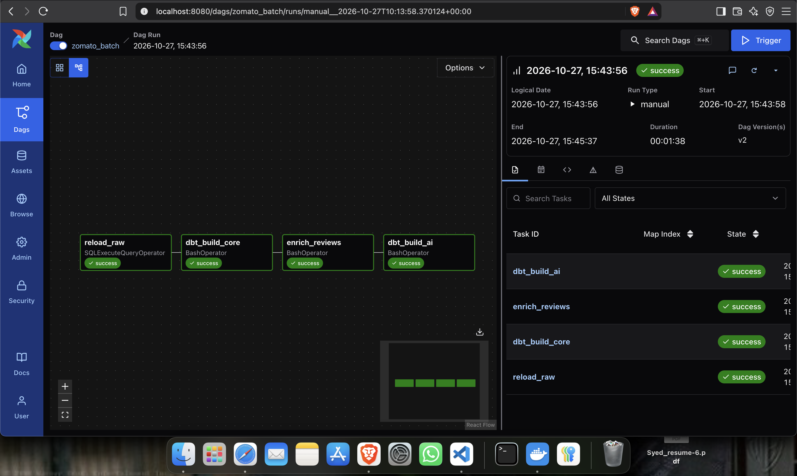
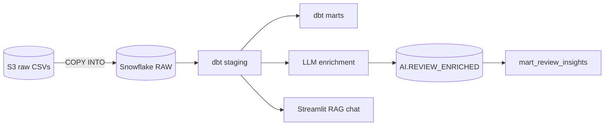
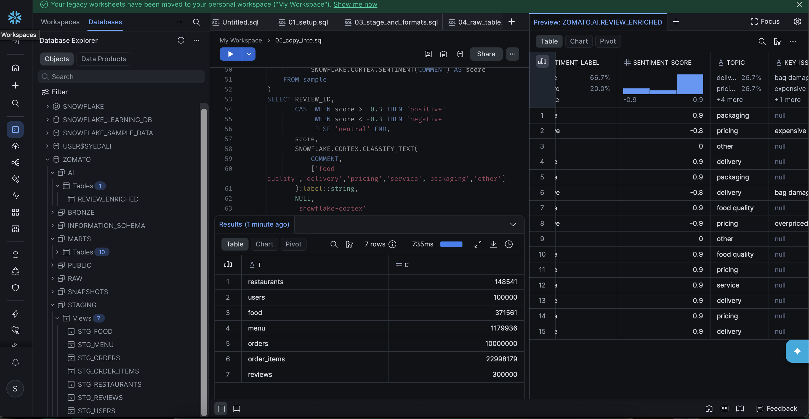

# Zomato Data Platform

End-to-end batch pipeline on **35M+ rows** of food-delivery data: **S3 → Snowflake → dbt → Airflow → LLM enrichment → RAG chat**.




## Architecture



Airflow runs it daily: `reload_raw → dbt_build_core → enrich_reviews → dbt_build_ai`

## Highlights

- **35.1M rows** loaded: 23M order items, 10M orders, 1.2M menu rows, 300K reviews and more
- **17 dbt models** (7 staging, 10 marts) with 12 tests: dimensions, incremental facts and business marts
- **Secure S3 access** through a Snowflake storage integration (IAM role + external ID), with no stored AWS keys
- **Incremental by design:** `COPY INTO` skips loaded files, and enrichment only processes new reviews
- **AI isolated from core:** AI models carry `tag:ai`, so the core pipeline runs even if enrichment is down
- **No secrets in the repo:** credentials come from `.env`, dbt `env_var()` and Compose variables

| Snowflake | S3 source |
|---|---|
|  |  |

## Structure

```
airflow/   DAG, Dockerfile, docker-compose
zomato/    dbt project (staging + marts)
ai/        enrich_reviews.py, rag_chat.py, text_to_sql.py
```

## Run it

```bash
cp .env.example airflow/.env        # fill in your values
cd airflow && docker compose up -d  # Airflow at http://localhost:8080
streamlit run ai/rag_chat.py        # review chat (needs Ollama running)
```

Add `zomato/profiles.yml` using `env_var()` for credentials (it is git-ignored). Snowflake setup (database, storage integration, stage, `DBT_ROLE`) is described in the dbt and DAG files.

## Limitations

Local-LLM enrichment is slow, so reviews are processed in batches rather than all 300K at once. The chat app searches a sample of reviews held in memory, not a vector index.
